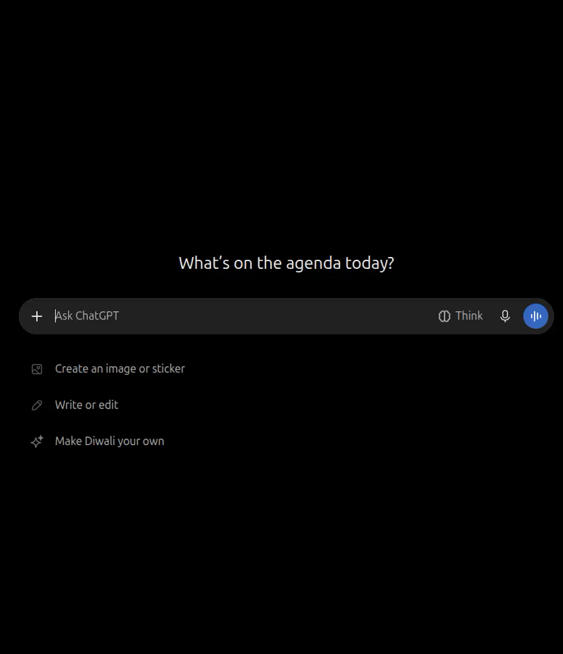
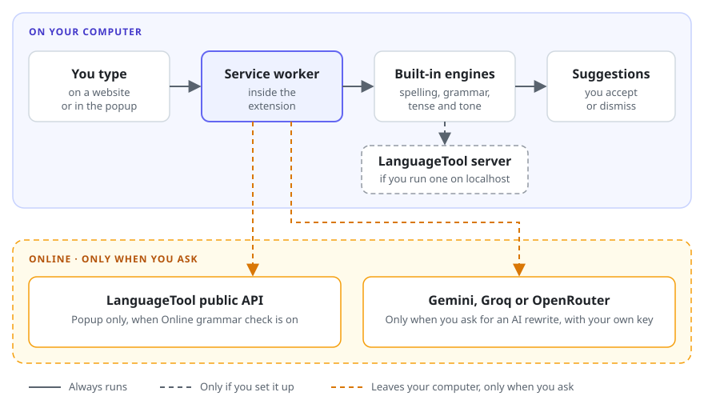

# WriteBetter – Polite Writing Chrome Extension

**A privacy-first grammar checker and writing assistant for Chrome.**

[](LICENSE)


WriteBetter is a Chrome extension (Manifest V3) that fixes spelling, grammar, tense and tone while you write in Gmail, Google Chat, WhatsApp Web, LinkedIn and Jira, and turns casual messages into polite or professional ones. Every check runs on your computer and works offline. AI rewriting is optional and uses your own Gemini, Groq or OpenRouter API key, so it is a local-first alternative to Grammarly-style tools that send what you type to a server.

## Contents

- [Features](#-features)
- [Why WriteBetter?](#-why-writebetter)
- [Screenshots](#-screenshots)
- [Before and after](#-before-and-after)
- [How it works](#-how-it-works)
- [Installation](#-installation)
- [Using WriteBetter](#-using-writebetter)
- [Configuration](#-configuration): [Settings](#settings), [AI rewriting](#ai-rewriting-optional), [local LanguageTool](#local-languagetool-server-optional), [online grammar check](#online-grammar-check-optional)
- [Privacy and security](#-privacy-and-security)
- [Permissions](#-permissions)
- [Website compatibility](#-website-compatibility)
- [Under the hood](#-under-the-hood)
- [Tech stack](#-tech-stack)
- [Project structure](#-project-structure)
- [Contributing](#-contributing)
- [Issues and feedback](#-issues-and-feedback)
- [Roadmap](#-roadmap)
- [License](#-license)

## ✨ Features

- **Spelling, grammar and tense checking:** a bundled English dictionary and local rules. No account, no server, works offline.
- **Make Polite, Professional and Fix Everything:** rewrite a casual or blunt message into a polite, professional one, then review every change before you replace your text.
- **Suggestions as you type:** on Gmail, Google Chat, WhatsApp Web, LinkedIn and Jira, with underlines, a suggestion card, Accept, Dismiss, Ignore and Undo. Works in rich-text editors, modal dialogs and shadow DOM, and you can add other sites in Settings.
- **Keyboard shortcuts:** Alt+Shift+G opens the suggestion at the cursor, and Ctrl+Shift+Space lists every suggestion in the field.
- **Optional AI rewriting:** with your own Google Gemini, Groq or OpenRouter key (free OpenRouter models work), in six styles: improve wording, professional, polite, concise, friendly and clearer.
- **Optional LanguageTool:** grammar checks from a server on your computer or, if you turn it on, LanguageTool's public API.
- **Light and dark themes:** for the popup, Settings and the suggestions on websites, or match your system.
- **Private by default:** your text is never stored, and nothing leaves your computer unless you turn on the online grammar check or AI rewriting.

## 🚀 Why WriteBetter?

Writing a clear, polite message takes time, especially to colleagues, clients or recruiters. WriteBetter helps you:

- Write professional emails and polite workplace messages.
- Fix grammar and spelling as you type, on the page where you are already writing.
- Turn a casual or blunt sentence into a polite or professional one.

Unlike tools that send everything you type to a server, WriteBetter:

- Runs its checks on your computer, with no account, and keeps working offline.
- Never changes your text without a click, and shows every change before you accept it.
- Sends text to an AI provider only when you ask, using your own key.

## 📸 Screenshots

_Screenshots and a short demo are coming soon._

<!--
Add the files to screenshots/, then remove this comment and the line above.

<p align="center">
  
</p>

| Suggestions as you type | The popup | Ctrl+Shift+Space with an AI rewrite |
|:---:|:---:|:---:|
|  |  |  |
-->

## 📝 Before and after

These come from the built-in engines alone, offline, with no AI and no LanguageTool server:

| You type | Button | WriteBetter suggests |
|----------|--------|----------------------|
| can you check the current ticket info | Make Polite | Could you please check the current ticket information? |
| can you check the current ticket info | Professional | Could you please review the information in the current ticket? |
| could you please fix this issue asap | Professional | Could you please fix this issue at your earliest convenience? |
| why didnt you reply to my mail | Make Polite | Was there a reason you were not able to reply to my mail? |
| send me the report now | Make Polite | Could you please send me the report now? |

The built-in engines keep your wording and change only what their rules cover. [AI rewriting](#ai-rewriting-optional) can rephrase more freely.

## 🧩 How it works



The top part always runs on your computer. Text only reaches the services in the bottom part when you turn them on or ask for them; [Privacy and security](#-privacy-and-security) lists exactly when.

### What works offline

| Feature | Offline | Notes |
|---------|---------|-------|
| Spelling | Yes | English dictionary is bundled; British spellings and accented words are accepted; long texts are checked within a 1.5 s budget |
| Local grammar and punctuation rules | Yes | Agreement, capitalization, question marks, spacing, repeated words, a/an |
| Tense rules | Yes | Only verbs in `src/engines/tense/verbLexicon.ts` are corrected |
| Polite and professional tone | Yes | Rule-based phrase and sentence transformations |
| LanguageTool grammar | Yes, once installed locally | Needs the Java server described under [Configuration](#local-languagetool-server-optional); nothing is sent to the internet |
| LanguageTool grammar, online | No | Only when you turn on **Online grammar check** in the popup |
| AI rewriting | No | Only when you press **Rewrite with AI** in the popup, or Ctrl+Shift+Space with its AI switch on, after adding your own API key in Settings |

## 📦 Installation

WriteBetter is not on the Chrome Web Store yet, so you build it from source and load it into Chrome.

**Requirements:**

- Node.js 20.19+ or 22.12+ (required by Vite) and npm
- Google Chrome 116+
- Optional: Java 17+ to run a local LanguageTool server

1. Clone this repository and go into it:

   ```bash
   git clone https://github.com/Shubham0202/WriteBetter.git
   cd WriteBetter
   ```

2. Install the dependencies and build the extension into `dist/`:

   ```bash
   npm install
   npm run build
   ```

3. Open `chrome://extensions` and switch on **Developer mode**.
4. Click **Load unpacked** and select the `dist/` folder.
5. Pin WriteBetter and click its icon. The header shows **Ready** when the popup can reach the background service worker.

Neither `dist/` nor `node_modules/` is committed, so run `npm install` and `npm run build` after every fresh clone.

Chrome treats an unpacked extension loaded from a different folder as a different extension, and keeps keyboard shortcuts separately for each profile. After a rebuild, use the reload icon on the extension card instead of loading it again from somewhere else.

## 💬 Using WriteBetter

### In the popup

1. Click the WriteBetter icon, then type or paste your text (up to 5,000 characters).
2. Press **Fix Grammar**, **Make Polite**, **Professional** or **Fix Everything**. Fix Everything fixes mistakes first and then rewrites in the tone chosen next to it.
3. Review the original, the corrected text and every change. Untick any change you do not want.
4. **Copy** the result, or **Replace input**, which **Undo** reverses. **Reset** clears the result.

The popup also has the **Online grammar check** switch, **Rewrite with AI**, and switches that pause suggestions on websites everywhere or only on the site you are on.

### On websites

1. Click into a text field on a supported site and type. When you stop typing for a moment (1 second by default), the field is checked.
2. Mistakes are underlined under the words themselves: a solid red line for spelling, dashed amber for grammar, dashed blue for tense, and dotted for uncertain suggestions. Underlines stay on their words as you type.
3. Hover a word, or move the caret into it, to open the suggestion card above the word (under it only when there is no room above). The badge in the corner of the field counts the suggestions and steps through them, including rewrites of sentences that have no mistake.
4. **Accept** replaces only that text, and the field checks the result before saying it worked. If the text changed in the meantime, or the site rejects the change, nothing is altered and you are told. Text is never changed without a click.
5. **Undo** in the message that follows, or Ctrl+Z, puts the text back.
6. **Dismiss** hides a suggestion in that field until the page is reloaded. **Ignore** adds a spelling word to your personal dictionary, which the popup also uses.

### Keyboard shortcuts

| Shortcut | What it does |
|----------|--------------|
| Alt+Shift+G | Opens the suggestion at the cursor |
| Ctrl+Shift+Space | Lists every suggestion in the field at once; press it again to close the list |

The list opens above the field, with Accept and Dismiss for each suggestion. It stays open while you work through it. Tab moves through the card, and Esc returns to the field with the cursor where it was. In the list, AI rewrites come first and the cursor starts on the first one's **Accept**, so Enter accepts it. Accepting an AI rewrite closes the list. Other suggestions keep it open, and the cursor moves to the Accept of the next one, unless **Close after Accept** is on in the list's header or in Settings; then every Accept closes the list. Up and Down, or Page Up and Page Down, move between suggestions and land on Accept, and Left and Right move to Dismiss (and Ignore) and back.

The shortcuts can be changed at `chrome://extensions/shortcuts`; Settings shows the key Chrome has for each and opens that page. Chrome keeps shortcuts per profile and leaves one unset when another extension in that profile already has its key. WriteBetter then still answers the default key on websites, unless another extension takes that key first.

The list also has a **Rewrite with AI** switch, off by default and the same as the one in Settings. While it is on, Ctrl+Shift+Space also sends the field's text to your AI provider, shows a loader in the list, and then adds the rewrite as items of their own, one per sentence where the sentences can be matched up and otherwise one for the whole text, each with Accept and Dismiss. Turning the switch on while the list is open starts a rewrite straight away. Opening the list again for the same text, in the same style, shows the earlier AI rewrite without a new request; accepting its suggestions or undoing them still counts as the same text, while typing does not. The AI row then has a **Regenerate** button to ask the AI again for the same text. Typing, closing the list or leaving the field cancels a rewrite that is still running. In rich-text editors a whole-text rewrite replaces the formatting of that text too, so per-sentence items are preferred whenever possible.

## 🔧 Configuration

### Settings

Open **Settings** from the popup, or from the extension's menu.

| Setting | What it does |
|---------|--------------|
| Show suggestions on websites | Turns everything off or on, at once and without a reload. The popup has the same switch. While off, pages have no field listeners at all |
| Spelling, Grammar and tense, Polite rewrites, Professional rewrites | Choose what the checks on websites look for. The popup buttons always run every check, because pressing one is an explicit request |
| Delay | How long to wait after you stop typing, from 0.5 to 3 seconds. The default is 1 second |
| Close the suggestion list after Accept | Off by default. Accepting an AI rewrite always closes the Ctrl+Shift+Space list; with this on, accepting any suggestion does too. The list has the same switch |
| Keyboard shortcuts | The key Chrome has for each shortcut in this profile, a warning when one is not set, and **Change shortcuts**, which opens `chrome://extensions/shortcuts` |
| Websites | Turn a site off to pause it there, or add one. Chrome asks for access to that site only, and removing the site gives that access back |
| Ignored words | The personal dictionary. Words can be removed here |
| AI rewriting | The provider, API key and model that **Rewrite with AI** uses, and whether Ctrl+Shift+Space rewrites with AI on websites and in which style. Optional; the key stays on this computer and **Remove key** deletes it |
| Appearance | Light, dark, or matching your system, for the popup, Settings and the suggestions on websites |

The popup can also pause the site you are on. Chat inside Gmail follows the Gmail switch; the Google Chat switch is for `chat.google.com` itself. Settings are saved in Chrome's local extension storage, on this computer.

### AI rewriting (optional)

The local engines fix mistakes but keep your wording. **Rewrite with AI** goes further: it rewrites the text in the popup so that it reads naturally and politely while still saying the same thing. It needs an API key from one of these providers, added once in Settings:

| Provider | Default model | Where to create a key |
|----------|---------------|-----------------------|
| Google Gemini | `gemini-3.6-flash` | https://aistudio.google.com/apikey |
| Groq | `openai/gpt-oss-120b` | https://console.groq.com/keys |
| OpenRouter | `liquid/lfm-3-1.7b:free` | https://openrouter.ai/workspaces/default/keys |

#### Recommended for a free key: OpenRouter

To try AI rewriting without paying, use OpenRouter. Create a key at **https://openrouter.ai/workspaces/default/keys** and use a model whose name ends in `:free`. Those models cost nothing. OpenRouter only serves them to accounts whose privacy settings allow free models, and it limits how often they can be called, so a request can occasionally be refused when you send many in a row.

These free models work with WriteBetter. All of them were listed as free on OpenRouter, with JSON output support, on 2026-11-08:

| Model | Name on OpenRouter | Context |
|-------|--------------------|---------|
| `liquid/lfm-3-1.7b:free` | LiquidAI LFM3-1.7B. The default: the smallest and fastest | 262K |
| `google/gemma-4-31b-it:free` | Google Gemma 4 31B | 262K |
| `google/gemma-4-26b-a4b-it:free` | Google Gemma 4 26B A4B | 262K |
| `nvidia/nemotron-3.5-super-vl:free` | NVIDIA Nemotron 3.5 Super VL | 1M |
| `xingchen-agi/xing4.0-29b-a4b:free` | XingChen Xing4.0 29B A4B | 262K |
| `dots-studio/dots-3-note-preview:free` | Dots Studio Dots3-Note Preview | 512K |
| `recursive/flint-v1.0:free` | Recursive Flint | 262K |
| `liquid/lfm-2.5-2.6b:free` | LiquidAI LFM2.5-2.6B | 65K |

The default model is the quickest. If its rewrites are too plain, try a larger model such as `google/gemma-4-31b-it:free`. Clicking the model field in Settings offers this same list. Free models come and go: browse the current ones at https://openrouter.ai/models?max_price=0. Any other model works too, as long as it supports JSON output.

#### Set it up

1. Open **Settings → AI rewriting**, choose the provider, paste the key and press **Save**. Leave the model empty to use the default, or type another model name there. For OpenRouter, clicking the field suggests free models that can rewrite.
2. In the popup, pick a style next to **Rewrite with AI** (Improve wording, Make professional, Make polite, Make concise, Make friendly or Improve clarity) and press the button. While there is no key, the button's neighbour says **Set up** and opens Settings.
3. Review the result like any correction: the original and the rewrite side by side, each change ticked or unticked, then **Copy** or **Replace input** (with **Undo**). Nothing changes until you choose to replace.

What is sent, and when: only the text in the popup and the chosen style, only when you press the button, straight from the extension to the provider over HTTPS. With **Rewrite with AI from the keyboard shortcut** turned on in Settings, pressing Ctrl+Shift+Space in a field on a website also sends that field's text, in the style chosen there. Checks as you type and the other popup buttons never use it, and no extra Chrome permission is involved. The key is kept in Chrome's extension storage on this computer, is only ever sent to the provider you chose, and **Remove key** deletes it. Read the provider's terms and privacy policy before sending work messages to it.

Every rewrite is checked before it is shown: it is not used if it changed or added a link, email address, @mention or code, or if it grew out of proportion, and a rewrite that only changes spacing counts as no change. Multi-sentence texts are offered sentence by sentence when the sentences still correspond, otherwise as one change. Requests give up after 30 seconds, **Cancel** stops one early, and closing the popup cancels it too. If the provider rejects the key or the model, the message in the popup says which one to check. Texts are limited to 5,000 characters, like every other correction.

### Local LanguageTool server (optional)

Without it, grammar is checked by the built-in local rules and the result says that LanguageTool was unavailable. With it, LanguageTool adds broader grammar and punctuation checks, and your text still never leaves your computer.

1. Download and unzip LanguageTool from https://languagetool.org/download/LanguageTool-stable.zip
2. In the unzipped folder, run:
   ```bash
   java -cp languagetool-server.jar org.languagetool.server.HTTPServer --port 8081
   ```
3. Run a correction again. The result's engine list shows **Grammar (LanguageTool) ran**.

The extension calls `http://localhost:8081/v2/check`; this address cannot be changed yet.

### Online grammar check (optional)

To use LanguageTool without installing anything, turn on **Online grammar check** in the popup. It is off by default.

- When it is on, **Fix Grammar** and **Fix Everything** send your text to [LanguageTool](https://languagetool.org)'s free public API (`https://api.languagetool.org/v2/check`) instead of the local server. Your text and IP address go to LanguageTool's servers; see their [privacy policy](https://languagetool.org/legal/privacy).
- **Make Polite** and **Professional** never use it.
- Checks as you type on websites never use it, whether the switch is on or off. LanguageTool's terms do not allow automated requests to the public API, and those checks would otherwise send what you type on every site.
- The API allows 20 requests a minute at peak, 75 KB a minute and 20 KB per request. It comes with no availability guarantee, and the limits can change. If it cannot be reached, grammar is checked with the local rules and the result says so.

## 🔒 Privacy and security

WriteBetter has no server of its own, no account and no analytics or tracking. The built-in checks run inside the extension on your computer.

Your text leaves your computer only in these cases, all off by default:

| When | Where it goes | What is sent |
|------|---------------|--------------|
| **Online grammar check** is on in the popup and you press **Fix Grammar** or **Fix Everything** | LanguageTool's public API | The text in the popup |
| You press **Rewrite with AI** in the popup | The AI provider you chose | The text in the popup and the chosen style |
| **Rewrite with AI from the keyboard shortcut** is on and you press Ctrl+Shift+Space in a field | The AI provider you chose | That field's text and the chosen style |

A LanguageTool server you run yourself listens on `localhost`, so using it sends nothing to the internet.

- **Never stored:** your text.
- **Saved in Chrome's local extension storage, on this computer:** your settings, your ignored words and, if you add one, your AI API key. The key is only ever sent to the provider you chose, and **Remove key** deletes it.
- **Never watched:** password, payment, one-time-code, read-only and code-editor fields.
- **Kept away from the page:** the suggestion UI lives in a closed Shadow DOM, so sites cannot restyle it or read the text in it.
- **Not trusted from the page:** messages to the background service are only accepted from the part of the extension that really sends them, and key presses a page fakes never trigger a shortcut.

When you use an online service, its own terms and privacy policy apply: see [LanguageTool's](https://languagetool.org/legal/privacy) and your AI provider's before sending work messages.

## 🔑 Permissions

| Permission | Why |
|------------|-----|
| `storage` | Remembers your settings, the Online grammar check switch, the words you chose to ignore and, if you add one, your AI API key |
| `scripting` | Injects the suggestion UI into a page the first time there is something to show, and registers sites you add |
| `http://localhost/*`, `http://127.0.0.1/*` | Lets the service worker reach a LanguageTool server running on this computer |
| Optional: access to any website (`*://*/*`) | Declared as optional, so nothing is granted at install. Adding a site in Settings asks Chrome for that one site |
| `mail.google.com`, `chat.google.com`, `web.whatsapp.com`, `www.linkedin.com`, `*.atlassian.net` | Runs the content script there and injects the suggestion UI. Password, payment, one-time-code, read-only and code-editor fields are never watched |

## 🌐 Website compatibility

| Tested | How |
|--------|-----|
| Inputs, textareas, contenteditable, fields inside shadow DOM, modal dialogs, popovers and iframes | Automated, in Chrome |
| Lexical, ProseMirror and Quill | Automated, against the real libraries, checking that each editor's own document receives the change |
| Gmail's reply layout | Automated, on a copy of its structure: quoted messages and signatures are not checked or changed |
| Gmail, Google Chat, WhatsApp Web, LinkedIn and Jira themselves | Not yet: these need a signed-in browser |

Most sites need nothing special, so `src/content/siteAdapters.ts` only holds what generic handling cannot work out. Fields inside closed shadow roots cannot be reached, and Google Docs draws its text on a canvas, so neither is supported. In an iframe shorter than the suggestion card, the card is cut off at the iframe's edge.

## 🔬 Under the hood

### How a correction runs

1. The popup validates the text (not empty, at most 5,000 characters) and sends it to the service worker.
2. `src/services/correctionPipeline.ts` runs the engines for the chosen button. Each engine is a plain function that returns suggestions against the original text: offset, original, replacements, category, explanation, source and confidence.
3. Where suggestions overlap, targeted local rules win over LanguageTool, and LanguageTool wins over the dictionary. For **Fix Everything**, each sentence is corrected first and then rewritten in the chosen tone; the tone rewrite lists the corrections it includes.
4. `src/services/resultValidator.ts` drops suggestions that no longer match the text, touch URLs, emails, @mentions or `inline code`, would duplicate words or phrases, or would double punctuation ("??").
5. The popup shows the original, the corrected text and every change. High-confidence changes start ticked; uncertain ones (for example LanguageTool style hints) start unticked. Nothing changes the input until the user clicks **Replace input**, which can be undone.

If an engine is unavailable or fails, the others still run and the result says which engine did not.

### How a check on a website runs

1. The content script finds the supported field that has focus and waits until you stop typing for 1 second.
2. It sends the text to the service worker, which runs the same engines as the popup. Only the local LanguageTool server is used, never the online service. If that server fails, it is left alone for a minute.
3. A check is cancelled as soon as the text changes or you leave the field, so results for outdated text are never used.

The small content script runs on supported sites, and the suggestion UI (`inlineUi.js`) is only injected once there is something to show. Both are bundled as single files with size budgets that the build enforces.

## 🧰 Tech stack

| Part | Built with |
|------|------------|
| Extension | Chrome Manifest V3: a service worker, a content script, the popup and the Settings page |
| Language | TypeScript, strict |
| Popup and Settings | React 19 and Tailwind CSS 4 |
| Suggestions on websites | Plain DOM in a closed Shadow DOM, with no framework, to keep the page script small |
| Spelling | [nspell](https://github.com/wooorm/nspell) with the [dictionary-en](https://github.com/wooorm/dictionaries) English dictionary |
| Grammar, tense and tone | Rule-based engines in `src/engines/`, plus optional [LanguageTool](https://languagetool.org) |
| AI rewriting (optional) | Google Gemini, Groq or OpenRouter, called directly with your own key |
| Build | Vite 8 |
| Tests and lint | Node's built-in test runner with tsx, ESLint and typescript-eslint |

## 📁 Project structure

```
public/manifest.json            Manifest V3 definition
public/icons/                   Extension icons (16, 32, 48, 128 px)
popup.html                      Popup page entry
options.html                    Settings page entry
vite.config.js                  Build: popup, settings page and service worker, plus content.js and inlineUi.js bundled
                                as single files with size budgets
eslint.config.js                Lint rules for browser and extension code
dist/                           Build output loaded into Chrome (generated, not committed)
docs/                           Images used in this README
src/
  background/serviceWorker.ts   Message router; runs the correction pipeline
  content/                      Content script for inline assistance: field detection and reading, change detection, checking, and the suggestion UI
    ui/                         Vanilla DOM for the underlines, card and badge (no React in web pages)
  components/                   Shared button, select and switch
  constants/                    Actions, tones, engines, categories, limits, labels, default settings, built-in sites, AI providers and rewriting styles
  engines/
    suggestion.ts               Suggestion model shared by all engines and the popup
    spelling/                   nspell checker, bundled dictionary, common misspellings
    grammar/                    LanguageTool client and local grammar rules
    tense/                      Verb lexicon, tense rules (each with examples) and runner
    tone/                       Polite and professional rules and the tone rewriter
    rewrite/                    AI rewriting: the prompt, the provider clients (Gemini, Groq, OpenRouter) and the rewrite suggestions
  fixtures/sentences.ts         Correct sentences no engine may change (used by tests)
  hooks/                        Hooks shared by the popup and the settings page
  options/                      Settings page: components and hooks
  popup/                        Popup UI: components and hooks
  services/                     Correction pipeline, writing enhancer (AI rewriting), latest-request runner, settings, AI settings, ignored words, keyboard shortcuts, result validator, messaging
  styles/                       Tailwind import and the brand colour tokens shared with the inline UI
  utils/                        Text, diff, validation and error helpers
```

## 🤝 Contributing

Contributions are welcome: bug fixes, site compatibility fixes, new rules and documentation. For a bigger change, please [open an issue](https://github.com/Shubham0202/WriteBetter/issues) first so we can agree on the approach.

1. Fork this repository and create a branch for your change.
2. Run `npm install`, then `npm run dev`, and load `dist/` in Chrome as described in [Installation](#-installation).
3. Keep the change focused, and add or update tests for engine and pipeline behaviour.
4. Run `npm test`, `npm run lint`, `npm run typecheck` and `npm run build` before you commit.
5. Open a pull request that says what changed and how you tested it, including the sites you tried.

```bash
npm run dev        # rebuilds dist/ on every file change
npm test           # unit tests for every engine and the pipeline (Node's built-in test runner, with tsx for TypeScript)
npm run lint
npm run typecheck  # TypeScript, strict
npm run build      # production build; fails if content.js or inlineUi.js grow past their size budgets
```

While `npm run dev` is running, click the reload icon on the extension card after each rebuild. Tabs already open on a supported site pick up the new version without being refreshed.

## 🐛 Issues and feedback

Found a bug or have an idea? [Open an issue](https://github.com/Shubham0202/WriteBetter/issues).

For a site where suggestions do not appear or Accept does not work, include the site, the kind of field (for example a reply box or a chat message) and what happened. For a wrong suggestion, include the sentence and the suggestion you got.

## 🧭 Roadmap

- [x] Extension setup, popup ↔ service worker messaging
- [x] Popup: Fix Grammar, Make Polite, Professional, Fix Everything, result review, Copy / Replace input / Undo / Reset
- [x] Engines: spelling (nspell), grammar (LanguageTool + local rules), tense rules, polite and professional tone, result validation
- [x] Settings page (suggestion checks, delay, websites, ignored words, keyboard shortcuts, appearance, privacy summary)
- [x] Optional online grammar check in the popup (off by default)
- [x] Inline assistance on websites, phases 1–7 of 8: detects the editable field you are typing in on supported sites, checks its text with the local engines once you pause typing, shows underlines, a suggestion card and a badge on the page, lets you accept, dismiss, ignore and undo, handles rich-text editors, modal dialogs and shadow DOM, and has settings and pause controls
- [x] Rewrite with AI in the popup: Gemini, Groq or OpenRouter with your own API key, six styles, preview, accept or reject, Replace input, Undo
- [x] Rewrite with AI from Ctrl+Shift+Space on websites: optional switch in the suggestion list and in Settings, loader, result listed with the other suggestions
- [x] Light and dark themes
- [ ] Choosing the LanguageTool server address
- [ ] Inline assistance, phase 8: final testing and optimization
- [ ] Testing on the real Gmail, Google Chat, WhatsApp Web, LinkedIn and Jira sites, in a signed-in browser

## 👤 Author

Shubham Chandgude ([shubham826852@gmail.com](mailto:shubham826852@gmail.com))

## 📄 License

This project is licensed under the [MIT License](LICENSE). Copyright (c) 2026 Shubham Chandgude.

---

**WriteBetter – Make every message sound better.**
